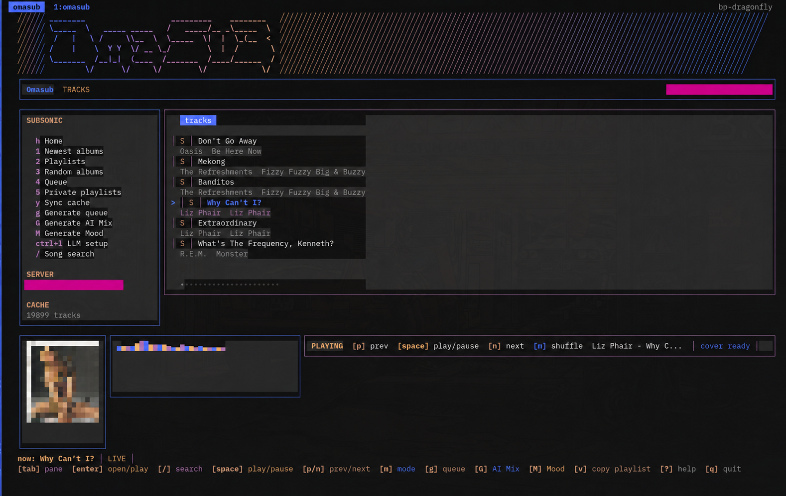
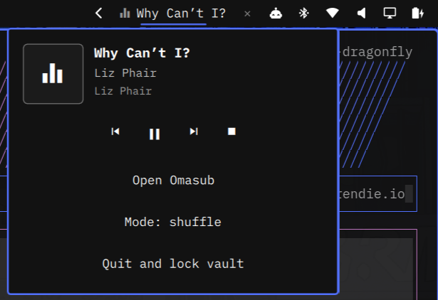

# Omasub



Omasub is a direct rejection of the enshittified music scene. Run your own
Navidrome server with music that you OWN, and use the power of your own agents
to make curated playlists.

No rented catalog. No engagement funnel deciding what comes next. No platform
quietly deleting an album when a licensing deal collapses. Omasub is an
Omarchy-native, terminal-first Subsonic client built with Bubble Tea for people
who want their collection, playback history, playlists, and recommendations
under their own control.

The interface belongs on your desktop: it follows the selected Omarchy theme,
including live theme changes, and keeps its title gradient inside that palette.
`mpv` handles playback, `ffmpeg` drives the visualizer, and album art renders
directly in the terminal. Your server supplies the music. Your machine keeps the
memory.

```text
________                   _________    ________
\_____  \   _____ _____   /   _____/__ _\_____  \
 /   |   \ /     \\__  \  \_____  \|  |  \_(__  <
/    |    \  Y Y  \/ __ \_/        \  |  /       \
\_______  /__|_|  (____  /_______  /____/______  /
        \/      \/     \/        \/            \/
```

## Own the Whole Listening Stack

- Browses the albums, tracks, and playlists on your own Subsonic-compatible
  server—without an algorithmic storefront in the way.
- Streams through `mpv` with play/pause, next/previous, queue editing, shuffle,
  shuffle/repeat, repeat-all, and repeat-one modes.
- Renders square pixel-art covers and a live audio visualizer in the TUI.
- Encrypts play history, queue snapshots, cached metadata, private playlists,
  recommendation recipes, and curator runs in a local SQLite vault.
- Syncs the Subsonic cache automatically after the first vault unlock so search
  and recommendations work immediately.
- Puts your current Omarchy agent to work curating the music you actually own,
  with Ollama and vLLM available as local alternatives.
- Includes an Omarchy shell widget for playback status, remote controls,
  playback modes, terminal focus, and secure session shutdown.

## Omarchy Integration

Omasub does not bring a foreign design system onto your desktop. It reads the
active palette through Omarchy's theme color contract. A running TUI notices
theme changes automatically; text, panels, borders, selections, visualizer
colors, and the title gradient all update without restarting the listening
session.

The curator uses the agent you already chose. It resolves `omarchy default
agent` at request time, so changing your default changes the next curator run
without another Omasub configuration pass.

The companion widget is installed as a user-owned Omarchy shell plugin. It
launches Omasub in the default terminal and keeps the application inside a
persistent listening session. Closing the terminal detaches the interface while
playback, queue state, and the unlocked vault remain alive. Opening Omasub from
the widget restores and focuses that same session.



The widget provides one-click access to:

- Previous, play/pause, next, and stop
- A single mode button that cycles its label through `normal`, `shuffle`,
  `shuffle/repeat`, `repeat all`, and `repeat one`
- Reopening or focusing the Omasub terminal
- **Quit and lock vault**, which ends playback, closes the persistent session,
  and clears the vault key from memory

Hardware media keys prefer Omasub while its listening session is live and fall
back to Omarchy's selected media source otherwise. On keyboards without track
keys, `Alt+Play` advances and `Alt+Shift+Play` goes back.

## Requirements

- Go 1.25 or newer
- `mpv` for playback
- `ffmpeg` for the reactive visualizer
- A C compiler for SQLite
- A Navidrome or Subsonic-compatible server
- Omarchy for live theme, default-agent, widget, terminal-session, and media-key
  integration

The core TUI can run outside Omarchy using terminal-safe fallback colors.

## Build and Install

On Omarchy, clone the public repository and run the installer. It builds the
application, installs it into `~/.local/bin`, adds that directory to the shell
path, installs and enables the widget, and wires the media keys:

```sh
git clone https://github.com/bprendie/omasub.git
cd omasub
./scripts/install.sh
```

Use `--no-launch`, `--no-llm-setup`, or `--no-widget` for unattended and partial
installs. Outside Omarchy, the same script installs the core application and
skips the shell integration.

### Install from Omarchy Plugins

Once the public repository is available, Omarchy can install the bar widget
directly:

```sh
omarchy plugin add https://github.com/bprendie/omasub.git --enable
```

The marketplace installation provides the widget. It expects `omasub` and
`omasub-media-key` in `PATH`, plus `tmux` and `jq`; the full installer above
builds those executables and installs all required integration in one pass.

The widget is an unsandboxed local plugin. It invokes `omasub`, `tmux`, `jq`,
`hyprctl`, and `omarchy-launch-tui`; it does not request root privileges or
write outside your user configuration, state, cache, and local binary paths.

To remove a full installation safely:

```sh
./scripts/uninstall.sh
```

Removal preserves your server configuration, encrypted vault, cache, queue,
and listening history. To remove only the marketplace widget, run:

```sh
omarchy plugin remove io.github.bprendie.omasub
```

To build directly from the checkout:

```sh
go build -o omasub ./cmd/omasub
./omasub
```

On Windows with a working C toolchain:

```powershell
powershell -ExecutionPolicy Bypass -File .\scripts\install.ps1 -SkipLaunch
```

Omarchy shell plugin files hot-reload. If the widget ever needs a clean bounce:

```sh
omarchy restart shell
```

## First Launch and the Vault

Run:

```sh
omasub
```

First launch connects Omasub to the server you control, tests the connection,
and creates the private vault. Configuration is written with private
permissions to:

```text
~/.config/omasub/config.json
```

The encrypted SQLite vault lives under the platform data directory as
`omasub/vault.sqlite3`. There is no account-recovery desk and no cloud copy
waiting behind the scenes. Back up the vault and keep the password somewhere
safe.

Environment variables can override the saved connection:

```sh
export OMASUB_SERVER="https://music.example.com"
export OMASUB_USER="your-user"
export OMASUB_PASSWORD="your-password"
```

After the vault unlocks for the first time, Omasub performs an encrypted library
cache sync automatically. Later refreshes are manual with `y`.

## Omarchy Curator

Your agents should work for your library—not feed another recommendation
platform. Fresh configurations use the current Omarchy default agent. No model
name, endpoint, or API key is required for that provider.

To select Omarchy, Ollama, or vLLM from the command line:

```sh
omasub --configure-llm
```

You can also press `ctrl+l` inside the TUI. Ollama and vLLM retain endpoint and
model discovery, manual model entry, context-window settings, and API-key
support.

The curator receives only a bounded set of candidates from your encrypted
cache. It must return real track IDs from your collection, and Omasub validates
every result before it can enter a playlist or queue. Hallucinated inventory
does not get a vote.

- `G` opens AI Mix creation, including a free-form request grounded against the
  synced library.
- `M` creates or replaces the server-side `Mood` playlist around the currently
  playing track without restarting it.
- `g` builds a deterministic queue locally without an LLM.

## Keyboard Controls

### Navigation and library

| Key | Action |
| --- | --- |
| `h` | Home |
| `1` | Newest albums |
| `2` | Server playlists |
| `3` | Random albums |
| `4` | Queue |
| `5` | Private playlists |
| `/` | Search cached tracks, then the server |
| `tab` / `shift+tab` | Move focus between sidebar and main pane |
| `enter` | Open or play the selected item |
| `left` / `esc` | Go back or leave the active prompt |
| `?` | Full in-app help |

### Playback and queue

| Key | Action |
| --- | --- |
| `space` | Play/pause |
| `n` / `p` | Next/previous track |
| `s` | Stop playback |
| `m` | Cycle normal, shuffle, shuffle/repeat, repeat all, repeat one |
| `a` | Add the selected or active track to the queue |
| `w` | Save the queue as a private playlist |
| `x` | Remove the selected queue row |
| `c` | Clear the queue |
| `u` / `d` | Move the selected queue row up/down |
| `r` | Create a server station from the active track |
| `ctrl+r` | Rename the selected playlist or station |

When the active queue or its source playlist is visible, the cursor and viewport
follow the currently playing track through in-app, widget, and media-key
transitions. Browsing a different playlist is left undisturbed.

### Cache, curation, and playlists

| Key | Action |
| --- | --- |
| `y` | Refresh the encrypted Subsonic cache |
| `g` | Generate a deterministic queue |
| `G` | Generate an AI Mix |
| `M` | Generate the Mood playlist from the active track |
| `ctrl+l` | Configure the curator provider |
| `v` | Copy a server playlist to the vault or a private playlist to the server |
| `delete` | Begin playlist deletion with confirmation |
| `q` / `ctrl+c` | Quit Omasub and lock the vault |

## Remote Control

The running TUI owns a private Unix socket and publishes a minimal atomic status
snapshot under the XDG state directory. The snapshot contains playback display
data only; credentials, vault contents, playlists, and curator prompts are never
exposed.

```sh
omasub remote status
omasub remote toggle
omasub remote previous
omasub remote next
omasub remote stop
omasub remote mode
omasub remote quit
```

The widget and media-key helper use this same bridge, so every controller acts
on one player and one queue.

## Your Music Leaves on Your Terms

- Server credentials remain in the private Omasub configuration file.
- Queue snapshots survive restarts.
- Play history and private playlists stay local and encrypted.
- Cached library metadata and recommendation records remain in the vault.
- Copying a playlist never mutates its source.
- Deleting a playlist does not stop the current player or replace its queue.
- Closing the terminal does not expose or relock the vault; **Quit and lock
  vault** ends the listening session and clears the in-memory key.

Run your server. Own your files. Choose your agents. Keep the history. Omasub is
built for a music collection that cannot be repriced, revoked, or optimized
against you.
